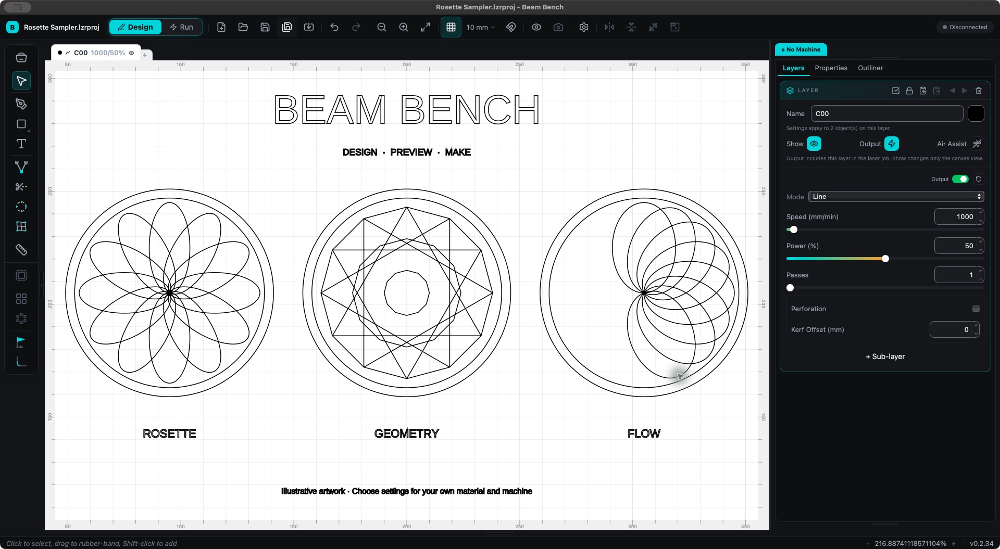

# Beam Bench

**Design, preview, and run laser-cutting and engraving jobs on Windows, macOS,
and Linux.** Free software, licensed under GPL-3.0-or-later.

[Download Beam Bench](https://beambench.com/en#download) ·
[Documentation](https://beambench.com/en/docs) ·
[Releases](https://github.com/schmnr/beambench/releases) ·
[Get support](https://beambench.com/en/support)



*The native desktop app with [sample vector artwork](examples/rosette-sampler.svg).
The machine is disconnected. The displayed settings are illustrative, not a cutting recipe.*

## Download

| Platform | Package | Requirements |
| --- | --- | --- |
| [Windows](https://beambench.com/en#download) | Signed x64 setup installer | Windows 10 or 11, x64 |
| [macOS](https://beambench.com/en#download) | Signed and notarized universal DMG | macOS 10.15 or later, Apple Silicon or Intel |
| [Linux](https://beambench.com/en#download) | x86_64 AppImage | Ubuntu 22.04 or a compatible distribution with the required desktop libraries |

The [download page](https://beambench.com/en#download) lists the current installers.
The [installation guide](https://beambench.com/en/docs/get-started/install) covers
platform requirements. Standalone CLI archives, checksums, updater signatures,
and corresponding source are available with each [GitHub release](https://github.com/schmnr/beambench/releases/latest).

## What you can do

- Draw and edit vector artwork, arrange objects, work with text and curves, and
  import SVG, DXF, vector PDF, and common image files.
- Organize cuts and engraves into layers with their own speed, power, passes,
  and operation settings. Reuse material recipes and machine profiles.
- Preview vector and raster output, check placement and origins, and frame
  the intended job before starting it.
- Run supported controllers over USB, serial, or network connections. Use the
  [compatibility guide](docs/controller-compatibility.md) to check the exact
  controller, available controls, and physical-testing status.
- Keep a stationary computer in charge of the USB-connected laser while the
  desktop connects remotely. A laptop disconnection leaves the host's job
  running. See [remote-host setup](docs/remote-host.md).
- Use the [CLI and local API](docs/cli.md) for automation, project inspection,
  offline exports, and explicit machine-control workflows.

GRBL serial is the established controller path. Other adapters and named presets
have different evidence and feature limits; an experimental label or a model
preset is not a claim of physical validation. Check compatibility before connecting.

## Get started

1. [Install Beam Bench](https://beambench.com/en/docs/get-started/install).
2. Import your artwork or try the included [rosette sampler](examples/rosette-sampler.svg).
3. Select your actual machine/controller and set the workspace and material settings.
4. Check the preview and placement, then follow the [first-burn guide](https://beambench.com/en/docs/get-started/first-burn).

For a fixed overhead camera, use the [calibration guide](docs/camera-calibration.md).
For disappearing USB ports on Linux, see [serial troubleshooting](docs/linux-serial-troubleshooting.md).

## Help and contributions

- [Product support](https://beambench.com/en/support): setup questions, diagnostics,
  installation and connection help. The app can submit a report from **Help > Report a Bug**.
- [Issue forms](https://github.com/schmnr/beambench/issues/new/choose): reproducible
  bugs, feature proposals, and machine-preset requests.
- [Contributing](CONTRIBUTING.md): development setup, checks, and machine-control invariants.
- [Security policy](SECURITY.md): private vulnerability reporting. Keep credentials,
  private files, and unredacted diagnostics out of public issues.

## Build from source

Install stable Rust, Node.js 22.12 or newer, and the
[Tauri 2 platform prerequisites](https://v2.tauri.app/start/prerequisites/).
The interface is built with React and Tauri; imports, geometry, planning,
preview, and controller support live in the Rust workspace.

```sh
cargo build --workspace --exclude pdf417
cargo test --workspace --exclude pdf417
cd tauri-app
npm ci
npm run tauri dev
```

For a local macOS or Linux desktop package, run `npm run tauri build` from
`tauri-app`. On Windows, use PowerShell and the release configuration so native
C++ dependencies also link their runtime into the executable:

```powershell
cd tauri-app
npm ci
$cargoConfig = (Resolve-Path ../.cargo/windows-release.toml).Path
npm run tauri build -- --target x86_64-pc-windows-msvc -- --locked --config $cargoConfig
```

To stage and verify the Windows CLI from the repository root:

```powershell
node tauri-app/scripts/build-cli-release.mjs --target x86_64-pc-windows-msvc
```

Local builds do not acquire the official release's signing or notarization.
See [release instructions](docs/releasing.md) for signed packages and updater
validation, and [dependency security](docs/dependency-security.md) for maintained backports.

## License and source

Beam Bench is free software under **GPL-3.0-or-later**. You may use, study,
modify, and redistribute it under the terms in [LICENSE](LICENSE).
Version tags and corresponding-source archives accompany the binary
[releases](https://github.com/schmnr/beambench/releases).

Bitmap tracing includes a Rust port and modification of Potrace 1.16,
Copyright (C) 2001-2019 Peter Selinger. Those files retain their GPL-2.0-or-later
notices. See the [Potrace notice](crates/beambench-core/src/potrace/README.md),
[third-party notices](THIRD_PARTY_NOTICES.md), and
[package licenses](THIRD_PARTY_LICENSES.md).

Commercial use is permitted under the GPL. Modified distributions must meet
its source and licensing requirements. Use of the Beam Bench name and branding
is covered separately by [TRADEMARKS.md](TRADEMARKS.md).
